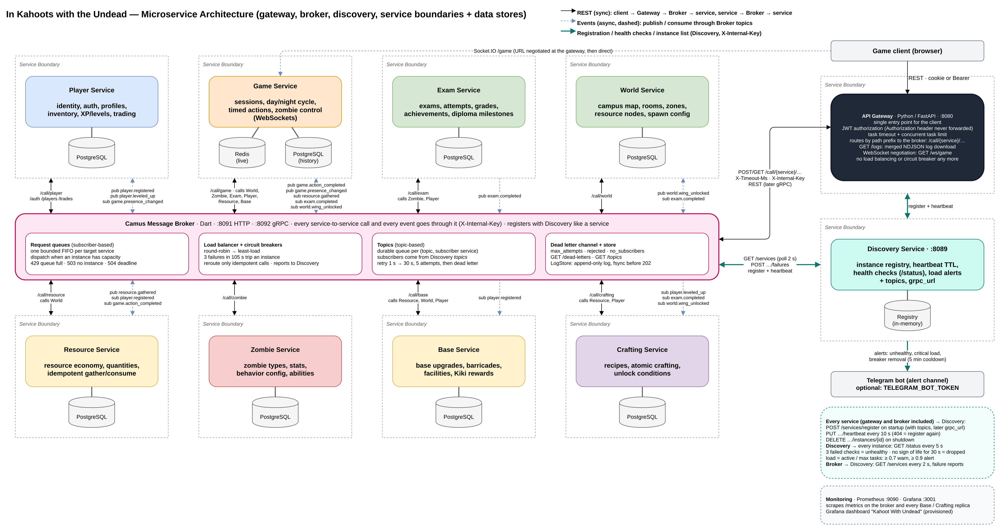

## Kahoot With Undead

A university-themed survival game built as a microservices system. Players wake up in FAF Cab
during a zombie apocalypse and must scavenge resources, build up their base, and fend off zombies —
including Professor Zombies, who force a pop quiz before letting you past. Passing exams unlocks new
wings of the university to explore, tying academic progress directly to survival progress.

[](https://hub.docker.com/r/timurcravtov/gateway)
[](https://hub.docker.com/r/inercaso/service-discovery)
[](https://hub.docker.com/r/timurcravtov/player-service)
[](https://hub.docker.com/r/timurcravtov/game-service)
[](https://hub.docker.com/r/inercaso/exam-service)
[](https://hub.docker.com/r/inercaso/world-service)
[](https://hub.docker.com/r/nevaletik/kahoot-zombie-service)
[](https://hub.docker.com/r/nevaletik/kahoot-resource-service)
[](https://hub.docker.com/r/mixam052/kahoots-base-service)
[](https://hub.docker.com/r/mixam052/kahoots-crafting-service)

[](docs/postman/service-discovery)
[](docs/postman/player-service)
[](docs/postman/game-service)
[](docs/postman/exam-service)
[](docs/postman/world-service)
[](docs/postman/zombie-service)
[](docs/postman/resource-service)
[](docs/postman/base-service)
[](docs/postman/crafting-service)
[](docs/postman/broker)
[](docs/postman/operations)
[](docs/postman/all-services)

Lab 4: what is implemented and where is in [`DONE.md`](DONE.md); what each team service still
has to do is in [`TODO_per_service.md`](TODO_per_service.md).


## Architecture



- **Gateway**: the single entry point for clients: authorization, task limits, routing by path prefix to the broker, WebSocket negotiation
- **Camus Message Broker** (Dart, ports 8091 HTTP / 8092 gRPC): carries every call between the Gateway and the services and between services (per-service request queues, load balancing, circuit breakers), and every event (topics with durable queues, retries, dead letter channel). Design: [`architecture.md`](https://github.com/TimurCravtov/CamusMessageBroker/blob/main/docs/architecture.md)
- **Service Discovery**: the registry of running instances and the topics they consume: health checks, load alerts, Telegram notifications
- **Player**: identity, auth, profiles, XP/levels, inventory, trading
- **Game**: sessions, day/night cycle, timed actions, zombie encounters
- **Exam**: exam generation, grading, academic history, achievements
- **World**: campus map: wings, rooms, resource nodes, spawn points
- **Zombie**: zombie type definitions, stats, abilities
- **Resource**: per-player resource balances and the gather/spend economy
- **Base**: what players have built: base level, facilities, barricades
- **Crafting**: recipes and crafting, delivering items into Player's inventory

Clients reach the REST APIs through the Gateway, which verifies the login and forwards each
request to the broker as `/call/{service}/...`; services call each other the same way, with
`X-Internal-Key`. The broker queues the request, picks a healthy instance, guards it with a circuit
breaker and returns the response. Events no longer travel over per-producer `/events` WebSockets:
a producer publishes to a broker topic (`POST /topics/{topic}/events`), and the broker delivers it
to one instance of every subscribing service (`POST /internal/events`), retrying and finally
dead-lettering what cannot be delivered. The topics a service consumes are declared in its Discovery
registration. Only Game's Socket.IO connection still goes directly from the browser to the service.
Game orchestrates a session by calling World, Zombie and Exam; Resource, Base and Crafting react to
what Game reports via topics, and publish their own events (level-ups, exam results, wing unlocks)
for services that depend on them. The diagram's source is [`docs/architecture.drawio`](docs/architecture.drawio).
See the [Communication Contract](docs/communication.md) for the full endpoint and event contract
(not yet rewritten for the broker; tracked by the Lab 4 contract tasks).

## Running

`docker-compose.yml` brings up every published service together, each with its own Postgres
instance (one DB per service, no shared tables), pulling images from Docker Hub — it never builds
from a service's Dockerfile.

Requirements: Docker with Compose v2, and the service ports below free on your machine.

```
cp .env.example .env   # adjust credentials/tags if needed
docker compose -f docker-compose.client.yml up   # every service and the React client
docker compose up                                # every service, without the client
```

`docker-compose.yml` holds the backend; `docker-compose.client.yml` includes it and adds the client.

| Service | URL |
|---|---|
| **Client** (React app, only with `docker-compose.client.yml`) | http://localhost:3000 |
| **Gateway** (entry point) | http://localhost:8080 |
| Game (Socket.IO only) | http://localhost:8090 |
| Service Discovery (registry, `X-Internal-Key`) | http://localhost:8089 |
| Message Broker (HTTP, `X-Internal-Key`; gRPC on 8092) | http://localhost:8091 |
| Grafana (dashboard "Kahoot With Undead"; anonymous view, `admin`/`admin` to edit) | http://localhost:3001 |
| Prometheus | http://localhost:9090 |

Only the gateway and Game's Socket.IO port are published, so every REST call from a client has to pass
the gateway's authorization. To reach a service directly while debugging (Player 8081, Exam 8083, World
8084, Zombie 8085, Resource 8086; each Base and Crafting replica gets a free host port, see
`docker compose port --index 1 base 8087`), add the override to either file:

```
docker compose -f docker-compose.yml -f docker-compose.dev.yml up
docker compose -f docker-compose.client.yml -f docker-compose.dev.yml up
```

**Scaling:** Player, Game, Exam, World, Zombie, Resource, Base and Crafting start with
`<SERVICE>_REPLICAS` (`PLAYER_REPLICAS`, `EXAM_REPLICAS`, ...; 2 each) replicas, Game with
`game` plus `GAME_EXTRA_REPLICAS` (1) more. Every
replica registers with Service Discovery and the gateway balances across them, so replicas can be
added and removed while everything runs:

```
docker compose up -d --scale base=3      # a third replica registers, the gateway sends it requests
docker compose up -d --scale base=1      # two stop, deregister, and leave the rotation
curl -H 'X-Internal-Key: changeme' localhost:8089/services   # what Discovery sees
```

Each response from the gateway names the replica that answered in `X-Upstream-Instance`. Game
replicas keep lobbies, presence and the event stream in `game-db`, so any replica can serve any
request. The `game` service publishes its Socket.IO port on `GAME_HOST_PORT` (8090) and
`game-replica` runs `GAME_EXTRA_REPLICAS` (1) more without a host port, because replicas started
together race for a port range. The gateway hands every browser the same `GAME_PUBLIC_WS_URL`, so
browser sockets all land on `game`; the others serve REST and the `/events` stream. Scale Game with
`--scale game-replica=3`.

### Gateway

- **Repository:** [`services/gateway`](https://github.com/TimurCravtov/KahootWithUndeadGateway),
  Python / FastAPI (the lab's "banned" language).
- **Image:** [`timurcravtov/gateway`](https://hub.docker.com/r/timurcravtov/gateway), version set
  by `GATEWAY_SERVICE_TAG` (currently `3`; the Lab 4 behaviour below needs the image released from
  the gateway's Lab 4 branch, see [`DONE.md`](DONE.md)).
- **Routes** by the first path segment to the owning service (prefixes in the
  [Communication Contract](docs/communication.md#conventions)) **through the message broker**:
  `Broker.Call` over gRPC (`GATEWAY_BROKER_TRANSPORT=grpc`, or `http` for `/call/{service}/...`).
  The broker picks the instance (least load), runs the circuit breakers and reroutes; the gateway
  has no balancer or breaker of its own. Every response names the instance in `X-Upstream-Instance`.
- **Authorizes** every client request: the login JWT (`Authorization: Bearer` or the
  `access_token` cookie) is verified with Player's JWKS, fetched through the broker
  (`GATEWAY_AUTH_MODE=jwks`; `secret` for HS256 with `GATEWAY_JWT_SECRET`, `off` to disable). The
  `Authorization` header and the cookie are never forwarded; services receive the verified player as
  `X-Player-Id` and **`X-Caller: client`**, so they treat it as the player's request even though the
  broker sends its own `X-Internal-Key`.
- **Only client routes:** `/<prefix>/internal/...` and the old event stream negotiation
  `GET /ws/{producer}` answer `404`. `GATEWAY_LEGACY_SERVICE_ROUTES=true` (the compose default until
  every service uses the broker) lets services holding `X-Internal-Key` reach them again.
- **Limits:** requests past `GATEWAY_TASK_TIMEOUT` seconds answer `504`, requests beyond
  `GATEWAY_MAX_CONCURRENT_TASKS` in flight answer `429`. Every service enforces the same limits
  itself (`408` / `429`).
- **WebSockets:** `GET /ws/game` returns Game's Socket.IO URL for the browser. The gateway never
  relays the connection.
- **Logs:** `GET /logs` (`X-Internal-Key`) downloads the logs of the whole system, see
  [Logs](#logs).
- **Status and metrics:** `GET /status` reports its load like every service, `GET /metrics` feeds
  Prometheus, and the gateway registers itself with Discovery.
- **Try it:** http://localhost:8080/docs, health check `GET /health`.

### Service Discovery

- **Repository:** [`services/service-discovery`](https://github.com/inercaso/KahootWithUndeadDiscovery),
  Python / FastAPI (the lab's "banned" language).
- **Image:** [`inercaso/service-discovery`](https://hub.docker.com/r/inercaso/service-discovery),
  version set by `DISCOVERY_SERVICE_TAG` (currently `3`).
- **Registry:** every instance registers itself on startup (`POST /services/register` with its own
  container address), sends a heartbeat every few seconds and deregisters on shutdown; every service
  gets `DISCOVERY_URL: http://discovery:8089`. The gateway fetches `GET /services` every 2 s and
  routes to the healthy instances, round-robin. All registry routes need `X-Internal-Key`.
- **Health checks:** every `DISCOVERY_HEALTH_INTERVAL_S` (5 s) it calls each instance's `/status`;
  `DISCOVERY_FAILURE_THRESHOLD` (3) failed checks in a row take the instance out of rotation, and
  `DISCOVERY_HEARTBEAT_TTL_S` (30 s) without a sign of life drop it. A caller whose circuit breaker
  trips reports the instance with `POST /services/{service}/instances/{id}/failures`.
- **Alerts:** load is `active_tasks / max_concurrent_tasks` from `/status`. At
  `DISCOVERY_LOAD_WARN` (0.7) it logs a warning; at `DISCOVERY_LOAD_CRITICAL` (0.9), and when an
  instance stops answering, expires or is removed by a breaker, the alert also goes to Telegram,
  at most once per `DISCOVERY_ALERT_COOLDOWN_S` (300 s) per instance.
- **Telegram:** create a bot with @BotFather, add it to the team chat and send it `/chatid`; put
  the token in `TELEGRAM_BOT_TOKEN` and the chat ids, comma-separated, in `TELEGRAM_CHATS_IDS`
  in `.env` (never commit them). Without a token alerts only go to the log.
- **Lab 4:** an instance registers its `grpc_url` (the broker then calls it over gRPC) and the
  `topics` it consumes (the broker subscribes the service). It also serves `GET /metrics` and
  `GET /internal/logs` like every service.
- **Try it:** `curl -H 'X-Internal-Key: changeme' localhost:8089/services` lists every instance with
  its health and load; `GET /status` and `GET /health` are public. The Postman collection in
  [`docs/postman/service-discovery`](docs/postman/service-discovery) (also as a single importable
  `service-discovery.postman_collection.json`) walks the registry (register, heartbeat, report a
  failure, deregister) and sends requests through the gateway to show `X-Upstream-Instance`
  changing between replicas. Swagger UI at
  http://localhost:8089/docs; API reference:
  [`docs/openapi/service-discovery.openapi.json`](docs/openapi/service-discovery.openapi.json).

### Message Broker

- **Repository:** [`CamusMessageBroker`](https://github.com/TimurCravtov/CamusMessageBroker), Dart (a
  language no other service uses). Design: [`docs/architecture.md`](https://github.com/TimurCravtov/CamusMessageBroker/blob/main/docs/architecture.md).
- **Status:** Lab 4. The broker is a submodule (`services/broker`) and runs from `docker-compose.yml`
  as `timurcravtov/broker:4` (`BROKER_DOCKERHUB_USERNAME`, `BROKER_SERVICE_TAG`), with HTTP on
  `BROKER_PORT` (8091) and gRPC on `BROKER_GRPC_PORT` (8092), both published on the host. Events are
  kept on the `broker-data` volume (`BROKER_STORAGE=log`). Base and Crafting (`:4`) call other
  services through it over gRPC, are called back over gRPC and consume their topics; the other
  services still talk through the Gateway (`GATEWAY_LEGACY_SERVICE_ROUTES=true`) until they move to
  the contract below ([`TODO_per_service.md`](TODO_per_service.md)). A subscriber with no running
  instance keeps its subscriptions, and its events wait in its durable queue until it is back.
- **Role:** the only path between the Gateway and the services, between services, and for events.
  Clients never reach it; every non-public route needs `X-Internal-Key`. It registers with Discovery
  as `broker` like any service, and polls `GET /services` every 2 s for instances, health, load,
  `topics` and `grpc_url`.
- **Stays in the Gateway:** JWT check, task timeout and concurrent task limit for clients, routing by
  path prefix, `GET /logs`. **Moves to the broker:** choosing an instance, circuit breakers,
  service-to-service calls, events.

#### Contract: requests (subscriber-based queues)

`ANY /call/{service}/{original path}`, e.g. `GET /call/world/world/rooms/12`. The caller names the
target service and never picks an instance. Services use `BROKER_URL` where they used the Gateway URL.

| Header | Rule |
|---|---|
| `X-Internal-Key` | Required; the broker sets its own key on the upstream call. |
| `X-Player-Id`, `X-Request-Id`, `Idempotency-Key`, `Content-Type`, `Accept` | Forwarded; a missing `X-Request-Id` is minted. |
| `X-Timeout-Ms` | The caller's remaining budget; default and maximum `TASK_TIMEOUT_MS` (10 s). |
| `Authorization`, `Cookie` | Dropped. |
| `X-Upstream-Instance` (out) | The instance that answered, also on a failed call. |
| `X-Reroutes` (out) | How many other instances were tried first. |

The upstream's status and body come back unchanged. The broker adds only `429 TOO_MANY_REQUESTS`
(queue of 200 full, or concurrency limit; with `Retry-After`), `503 SERVICE_UNAVAILABLE` (no healthy
instance or breaker open) and `504 GATEWAY_TIMEOUT` (deadline passed while queued or in flight).

- **Queue:** one bounded FIFO per target service, in memory. A request is dispatched only when an
  instance has room (`max_concurrent_tasks` from Discovery minus the broker's own in-flight count).
- **Load balancing:** round-robin over healthy instances; least load
  (`(broker_in_flight + discovery_active_tasks) / max_concurrent_tasks`) with `LB_STRATEGY=least_load`.
- **Circuit breaker:** per instance; 3 failures (timeout, connection error, `5xx`) within
  `TASK_TIMEOUT_MS` × 3.5 trip it, log `circuit breaker tripped` and report it with
  `POST /services/{service}/instances/{id}/failures`. Resource commit and release stay allowed while
  a breaker is open (`CB_BYPASS_PATHS`).
- **Reroute:** a failed call goes to the next healthy instance within the deadline only if it cannot
  apply a write twice: the connection failed before sending, the method is `GET`/`HEAD`/`OPTIONS`, or
  the request has an `Idempotency-Key`.

#### Contract: events (topic-based queues)

A topic is an event type, `<service>.<event>`. Services declare the topics they consume in their
Discovery registration (`"topics": ["exam.completed"]`). The unit of subscription is the service: each
subscribing service gets one copy of every event, delivered to one healthy instance, through a durable
queue per (topic, subscriber).

| Topic | Producer | Subscribers |
|---|---|---|
| `player.registered` | Player | Base, Resource |
| `player.leveled_up` | Player | Crafting |
| `game.action_completed` | Game | Resource |
| `game.presence_changed` | Game | Player |
| `resource.gathered` | Resource | Game |
| `exam.completed` | Exam | World, Game, Crafting |
| `world.wing_unlocked` | World | Game, Crafting |

- **Publish:** `POST /topics/{topic}/events` with the existing envelope
  `{eventId, type, version, occurredAt, payload}`. `202` once the event is in every subscriber's queue
  and durably stored; `400` for an invalid envelope or a `type` that differs from the topic. A repeated
  `eventId` within 24 h answers `202` and enqueues nothing. Producers keep their outbox and mark a row
  sent only after the `202`.
- **Deliver:** `POST /internal/events` on the consumer, with `X-Internal-Key`, `X-Request-Id` and
  `X-Delivery-Attempt`. `2xx` acks. `5xx` or a timeout retries with backoff 1 s, 2 s, 4 s … 30 s,
  preferring another instance. A `4xx` other than 408/429, or more than 5 attempts, dead-letters the
  event. Delivery is at-least-once, so consumers keep deduplicating on `eventId` and answer `2xx` only
  after persisting.
- **Ordering:** one event in flight per queue (`QUEUE_PREFETCH=1`), so a subscriber sees a producer's
  events in order; a failing event blocks only its own queue.
- **Dead letters:** `GET /dead-letters?topic=&subscriber=&reason=&limit=&after=` lists them newest
  first with the full envelope, `reason` (`max_attempts`, `rejected`, `no_subscribers`), attempts and
  last status/error/instance. An event published to a topic nobody subscribes to is dead-lettered as
  `no_subscribers` (proposal).
- **Storage:** `STORAGE=log` appends every event to a log on the `broker-data` volume and fsyncs
  before the `202`; queues and dead letters are rebuilt on restart. `STORAGE=memory` (default) keeps
  nothing.

#### Endpoints (port 8091)

| Method | Path | Auth | Purpose |
|---|---|---|---|
| `GET` | `/health`, `/status` | public | Liveness; `/status` reports `active_tasks / max_concurrent_tasks` like every service |
| any | `/call/{service}/{path}` | key | Request queues |
| `POST` | `/topics/{topic}/events` | key | Publish an event |
| `GET` | `/topics` | key | Topics with producers seen, subscribers, queue depth, in-flight, published total |
| `GET` | `/dead-letters` | key | Dead letter channel |
| `GET` | `/metrics` | internal network | Prometheus text (grade 10) |

#### gRPC (grade 8)

One file, `proto/broker/v1/broker.proto`, owned by the broker repository; Base and Crafting keep a
copy and generate their Go stubs from it:

```proto
service Broker {                       // served by the broker, port 8092
  rpc Call(CallRequest) returns (CallResponse);
  rpc Publish(Event) returns (PublishAck);
}
service Endpoint {                     // served by every service
  rpc Handle(CallRequest) returns (CallResponse);
  rpc Deliver(Event) returns (DeliveryAck);
}
message CallRequest  { string service = 1; string method = 2; string path = 3;
                       map<string, string> headers = 4; bytes body = 5; }
message CallResponse { int32 status = 1; map<string, string> headers = 2; bytes body = 3; string instance = 4; }
message Event        { string event_id = 1; string type = 2; int32 version = 3; string occurred_at = 4; bytes payload = 5; }
```

- **One envelope, not a proto per service:** each service keeps its handlers. `Endpoint.Handle` feeds
  the call into the service's own router, and `Deliver` runs the same code as `POST /internal/events`,
  so the migration is one adapter per service.
- **Mapping:** the key travels as `x-internal-key` metadata, gRPC deadlines replace `X-Timeout-Ms`, and
  `RESOURCE_EXHAUSTED` / `UNAVAILABLE` / `DEADLINE_EXCEEDED` mean 429 / 503 / 504.
- **Migration:** a service adds `grpc_url` to its Discovery registration; the broker calls an instance
  over gRPC when it has one and over HTTP otherwise, so services move one at a time. The Gateway then
  calls the broker over gRPC too and drops the routes a player must not reach (`/<prefix>/internal/...`,
  `/ws/{service}`); `/ws/game` stays.

#### Configuration

| Variable | Default | Meaning |
|---|---|---|
| `PORT` / `GRPC_PORT` | `8091` / `8092` | Listen ports |
| `INTERNAL_KEY` | required | Shared secret; the broker refuses to start without it |
| `DISCOVERY_URL` | `http://discovery:8089` | Discovery |
| `TASK_TIMEOUT_MS`, `MAX_CONCURRENT_TASKS`, `REQUEST_QUEUE_MAX` | `10000`, `100`, `200` | Deadline, live tasks before `429`, per-service queue bound |
| `LB_STRATEGY`, `CB_BYPASS_PATHS` | `round_robin`, Resource commit/release | Balancing and breaker bypass |
| `CONCURRENCY_MODEL` | `inline` | `inline` or `isolate_per_request` (grade 7) |
| `QUEUE_PREFETCH`, `MAX_DELIVERY_ATTEMPTS`, `DEDUP_WINDOW_S` | `1`, `5`, `86400` | Event delivery |
| `STORAGE`, `DATA_DIR` | `memory`, `/data` | Storage |

Defaults are the design's proposals, not confirmed.

### Client

- **Repository:** [`services/client`](https://github.com/M1XaM/kahoots-client), React / Vite, served
  by nginx. Runs from `docker-compose.client.yml`, which includes the whole backend.
- **Image:** [`mixam052/kahoots-client`](https://hub.docker.com/r/mixam052/kahoots-client), version
  set by `CLIENT_SERVICE_TAG` (currently `2`).
- **Talks to:** the Gateway only. The browser calls the client's own `/api`, which nginx proxies
  to `http://gateway:8080`, so no service is reached directly.
- **Has:** one page per service, a status page for all of them, and the gateway's access rules
  and load behaviour.
- **Sign-in:** players register and log in through the Gateway at Player Service; the login cookie
  is all the app needs. Its service actions (starting an exam, granting XP or resources) send
  `X-Internal-Key`, taken from `CLIENT_DEV_INTERNAL_KEY`: the key reaches the browser, so set it
  on a local machine only.
- **Try it:** `docker compose -f docker-compose.client.yml up`, then http://localhost:3000.

### Player Service

- **Image:** [`timurcravtov/player-service`](https://hub.docker.com/r/timurcravtov/player-service),
  version set by `PLAYER_SERVICE_TAG` (default `3`).
- **Needs:** its own Postgres (`player-db`, started by compose); password defaults to `qwerty`, override with `PLAYER_POSTGRES_PASSWORD`.
- **Talks to:** Game, over its event stream: it asks the gateway for the stream URL (`GATEWAY_URL`) and
  keeps `online` in step with `game.presence_changed`. It issues the login cookie, publishes the JWKS
  the gateway verifies it with, serves `POST /players/{id}/xp` and streams `player.registered` and
  `player.leveled_up` on `ws://player:8081/events`.
- **Try it:** Postman collection in [`docs/postman/player-service`](docs/postman/player-service).

### Game Service

- **Image:** [`timurcravtov/game-service`](https://hub.docker.com/r/timurcravtov/game-service),
  version set by `GAME_SERVICE_TAG` (default `3`), `game` plus `GAME_EXTRA_REPLICAS` (1) `game-replica` replicas.
- **Needs:** its own Postgres (`game-db`, started by compose); password defaults to `qwerty`, override with `GAME_POSTGRES_PASSWORD`.
- **Scaling:** instance-agnostic: lobbies, the event outbox and which sockets are joined (so
  `game.presence_changed` fires when a player's first socket anywhere joins and their last one
  anywhere leaves) are all in `game-db`. A replica refreshes its sockets every 10 s, releases them on
  shutdown, and the survivors drop the ones of a replica that died after 30 s.
- **Talks to:** Player, World, Zombie, Exam, Resource and Base, always through the gateway
  (`GATEWAY_URL`, with `X-Internal-Key`). Until they run, starting a session or a timed action that
  depends on them will fail; creating lobbies works on its own. Game reads the acting player from
  `X-Player-Id`; the Socket.IO handshake checks the login cookie itself against Player's JWKS and
  publishes `game.presence_changed` on `ws://game:8082/events`.
- **Try it:** Postman collection in [`docs/postman/game-service`](docs/postman/game-service).
  Log in through the Player collection first, since Game authenticates with the login cookie.

### Exam Service

- **Image:** [`inercaso/exam-service`](https://hub.docker.com/r/inercaso/exam-service),
  version set by `EXAM_SERVICE_TAG` (currently `3`, the lab number; `latest` points at the newest).
- **Needs:** its own Postgres (`exam-db`, started by compose and seeded with the question bank and
  achievements from [`db/exam-service/init.sql`](db/exam-service/init.sql)); password defaults to
  `qwerty`, override with `EXAM_POSTGRES_PASSWORD`.
- **Talks to:** Zombie (a professor's subject) and Player (player check), always through the Gateway
  (`GATEWAY_URL`, with `X-Internal-Key`). `EXAM_ZOMBIE_CLIENT` / `EXAM_PLAYER_CLIENT` default to
  `http`; set them to `mock` to run Exam alone with built-in stand-ins (zombies `5`/`6`/`7` are
  math/physics/programming professors, `9` and `10` are not; every player id exists). Players are
  identified by the Gateway's `X-Player-Id`; the service never sees the token. Publishes
  `exam.completed` on `ws://exam:8083/events` (`GET /ws/exam` on the Gateway).
- **Limits:** a request past `EXAM_TASK_TIMEOUT_MS` (default 10 s) answers `408 REQUEST_TIMEOUT`;
  beyond `EXAM_MAX_CONCURRENT_TASKS` (default 100) in flight, `429 TOO_MANY_REQUESTS` with
  `Retry-After`.
- **Try it:** the Postman collection in [`docs/postman/exam-service`](docs/postman/exam-service)
  (also as a single importable `exam-service.postman_collection.json`) goes through the Gateway:
  run **Auth (run first)** to register and log in a player, then create and answer an exam.

### World Service

- **Image:** [`inercaso/world-service`](https://hub.docker.com/r/inercaso/world-service),
  version set by `WORLD_SERVICE_TAG` (currently `3`, the lab number; `latest` points at the newest).
- **Needs:** its own Postgres (`world-db`, started by compose and seeded with the campus map from
  [`db/world-service/init.sql`](db/world-service/init.sql)); password defaults to `qwerty`,
  override with `WORLD_POSTGRES_PASSWORD`.
- **Talks to:** Exam, over its event stream, negotiated at the Gateway (`WORLD_EXAM_EVENTS_URL`,
  default `gateway`: `GET /ws/exam`, then a direct connection; `off` = not connected, then events can
  be delivered over HTTP at `POST /world/internal/events`). A passed `exam.completed` unlocks the
  matching wing and publishes `world.wing_unlocked` on `ws://world:8084/events` (`GET /ws/world` on
  the Gateway). Players are identified by the Gateway's `X-Player-Id`; the service never sees the
  token.
- **Limits:** `WORLD_TASK_TIMEOUT_MS` (default 10 s, then `408 REQUEST_TIMEOUT`) and
  `WORLD_MAX_CONCURRENT_TASKS` (default 100, then `429 TOO_MANY_REQUESTS` with `Retry-After`).
- **Try it:** the Postman collection in [`docs/postman/world-service`](docs/postman/world-service)
  (also as a single importable `world-service.postman_collection.json`) goes through the Gateway:
  run **Auth (run first)**, then pass an exam through the Exam collection and the matching wing
  shows `unlocked: true`.

### Zombie Service

- **Image:** [`nevaletik/kahoot-zombie-service`](https://hub.docker.com/r/nevaletik/kahoot-zombie-service),
  version set by `ZOMBIE_SERVICE_TAG` (currently `3`, the lab number; each release is also tagged
  `<lab>.<minor>.<patch>` and `latest`), `ZOMBIE_REPLICAS` (2) replicas.
- **Needs:** its own Postgres (`zombie-db`, started by compose and seeded from
  [`db/zombie-service/init.sql`](db/zombie-service/init.sql) with ten definitions: ids `5`/`6`/`7`
  are the math/physics/programming professors, `9` and `10` are not, matching Exam's stand-in);
  password defaults to `qwerty`, override with `ZOMBIE_POSTGRES_PASSWORD`.
  `INTERNAL_KEY` is the `X-Internal-Key` every route except the health check expects.
- **Talks to:** nobody. Players reach `GET /zombies/{id}` through the Gateway, which verifies the
  token and forwards the player as `X-Player-Id`; the service never sees the token.
- **Scaling:** each replica registers with Service Discovery and answers `GET /status` with its load
  (`503` while its database is down). Definitions live only in `zombie-db`, so any replica answers
  any request. It calls no other service, so it has no circuit breaker.
- **Logs:** one JSON line per event in the shared format; `ZOMBIE_LOG_LEVEL` (`info`).
- **Try it:** the Postman collection in [`docs/postman/zombie-service`](docs/postman/zombie-service)
  (also as a single importable `zombie-service.postman_collection.json`) goes through the Gateway:
  run **Auth (run first)** to register and log in a player. API reference:
  [`docs/openapi/zombie-service.openapi.json`](docs/openapi/zombie-service.openapi.json) (Swagger UI
  is served at `/docs` on the service port, which compose does not publish).

### Resource Service

- **Image:** [`nevaletik/kahoot-resource-service`](https://hub.docker.com/r/nevaletik/kahoot-resource-service),
  version set by `RESOURCE_SERVICE_TAG` (currently `3`, the lab number; each release is also tagged
  `<lab>.<minor>.<patch>` and `latest`), `RESOURCE_REPLICAS` (2) replicas.
- **Needs:** its own Postgres (`resource-db`, started by compose and seeded from
  [`db/resource-service/init.sql`](db/resource-service/init.sql) with balances and ledger history
  for players `1`-`3`); password defaults to `qwerty`, override with `RESOURCE_POSTGRES_PASSWORD`.
  Other players get balances when `player.registered` is delivered for them.
- **Talks to:** Player and Game over their `/events` streams, negotiated at the Gateway
  (`RESOURCE_PLAYER_EVENTS_URL` / `RESOURCE_GAME_EVENTS_URL`, default `gateway`; empty = not
  connected, then events can be delivered over HTTP at `POST /resources/internal/events`), and World
  for node resource types through the Gateway (`RESOURCE_WORLD_SERVICE_URL`, default
  `http://gateway:8080`; empty = built-in copy of the rooms). It publishes `resource.gathered` on
  `ws://resource:8086/events` (`GET /ws/resource` on the Gateway). Players are identified by the
  Gateway's `X-Player-Id`; Base and Crafting reserve/commit through it with `INTERNAL_KEY`.
- **Scaling:** each replica registers with Service Discovery and answers `GET /status` with its load.
  Reserve, commit, release, steal and the event handlers run in one transaction holding a
  per-player advisory lock, so two replicas never spend the same balance; only one replica consumes
  each of Player's and Game's streams (another takes over within 5 s); any replica serves the whole
  `/events` stream from the shared outbox; an `Idempotency-Key` is claimed in the database, so a
  duplicate on another replica gets `409 IDEMPOTENCY_KEY_IN_USE`.
- **Circuit breaker:** 3 failed calls to World or the Gateway within 35 s (task timeout × 3.5) trip
  it; the failing instance named by `X-Upstream-Instance` is reported to Discovery, otherwise calls
  fail fast for 35 s and a single trial call decides whether it closes.
- **Logs:** one JSON line per event in the shared format; `RESOURCE_LOG_LEVEL` (`info`).
- **Try it:** the Postman collection in [`docs/postman/resource-service`](docs/postman/resource-service)
  (also as a single importable `resource-service.postman_collection.json`) goes through the Gateway:
  run **Auth (run first)** to register and log in a player, who gets zero balances from
  `player.registered`. Players `1`-`3` are seeded; the Events folder gives player 42 balances. API
  reference: [`docs/openapi/resource-service.openapi.json`](docs/openapi/resource-service.openapi.json)
  (Swagger UI is served at `/docs` on the service port, which compose does not publish).

### Base Service

- **Image:** [`mixam052/kahoots-base-service`](https://hub.docker.com/r/mixam052/kahoots-base-service),
  version set by `BASE_SERVICE_TAG` (currently `4`), `BASE_REPLICAS` (2) replicas.
- **Needs:** its own Postgres (`base-db`, started by compose); password defaults to `qwerty`, override with `BASE_POSTGRES_PASSWORD`.
- **Talks to:** Resource, World and Player through the message broker over gRPC (`Broker.Call` on
  `broker:8092`; `BASE_BROKER_TRANSPORT=http` uses `/call/{service}/...`). Until they run, spending
  endpoints (upgrades, barricades, Kiki) return `503 SERVICE_UNAVAILABLE`; reading and creating bases
  work on their own. The broker calls Base back over gRPC (`broker.v1.Endpoint` on port 9087,
  registered as `grpc_url`) and delivers the `player.registered` topic, declared in its Discovery
  registration, so a new player gets a base right after registering (once Player publishes the
  topic to the broker).
- **Limits:** `BASE_TASK_TIMEOUT_MS` (`408`) and `BASE_MAX_CONCURRENT_TASKS` (`429`), per replica.
- **Scaling:** each replica registers with Service Discovery and answers `GET /status` with its load.
  The broker delivers each event to one replica, every event is applied once in a transaction
  (deduplicated on `eventId`; a `4xx` answer dead-letters it, a `5xx` has it retried), and an `Idempotency-Key` is
  claimed in the database before the request runs, so a duplicate on another replica gets
  `409 IDEMPOTENCY_KEY_IN_USE`.
- **Circuit breaker / load balancing:** none of its own any more, the broker does both.
- **Logs:** one JSON line per event in the shared format; `BASE_LOG_LEVEL` (`info`).
- **Metrics:** `GET /metrics`, scraped by Prometheus (see [Monitoring](#monitoring)).
- **Try it:** Postman collection in [`docs/postman/base-service`](docs/postman/base-service).

### Crafting Service

- **Image:** [`mixam052/kahoots-crafting-service`](https://hub.docker.com/r/mixam052/kahoots-crafting-service),
  version set by `CRAFTING_SERVICE_TAG` (currently `4`), `CRAFTING_REPLICAS` (2) replicas.
- **Needs:** its own Postgres (`crafting-db`, started by compose); password defaults to `qwerty`, override with `CRAFTING_POSTGRES_PASSWORD`.
  Seeded from [`db/crafting-service/init.sql`](db/crafting-service/init.sql) with five recipes
  (two gated: one by level, one by a passed math exam and the Math Wing); their output items are
  seeded into Player's catalogue by [`db/player-service/init.sql`](db/player-service/init.sql).
- **Talks to:** Resource and Player through the message broker over gRPC, like Base. Until they run,
  crafting returns `503 SERVICE_UNAVAILABLE`; recipes and availability work on their own. The broker
  calls it back over gRPC (port 9088) and delivers the `player.leveled_up`, `exam.completed` and
  `world.wing_unlocked` topics to track levels, passed subjects and unlocked wings.
- **Limits:** `CRAFTING_TASK_TIMEOUT_MS` (`408`) and `CRAFTING_MAX_CONCURRENT_TASKS` (`429`), per replica.
- **Scaling:** like Base: registers with Service Discovery, the broker delivers each event to one
  replica, events applied once, `Idempotency-Key` claimed before a craft runs.
- **Circuit breaker / load balancing:** none of its own, the broker does both.
- **Logs:** shared JSON format; `CRAFTING_LOG_LEVEL` (`info`). **Metrics:** `GET /metrics`.
- **Try it:** Postman collection in [`docs/postman/crafting-service`](docs/postman/crafting-service).

## Monitoring

`docker compose up` also starts **Prometheus** (http://localhost:9090) and **Grafana**
(http://localhost:3001), configured from [`monitoring/`](monitoring):

- **Prometheus** ([`monitoring/prometheus/prometheus.yml`](monitoring/prometheus/prometheus.yml))
  scrapes every 5 s the gateway, Discovery, the broker's `GET /metrics` and every Base and Crafting replica (found through the
  compose DNS name, so `--scale base=3` is picked up). The broker sees every call and every event, so
  one target describes the whole system: calls by service and outcome, latency, request queues,
  reroutes, open circuit breakers, instance health and load, events published / delivered /
  dead-lettered and queue depth. Base and Crafting add their own requests by route and status,
  events consumed by outcome, calls to other services and active tasks. Data is kept for
  `PROMETHEUS_RETENTION` (7 days) on the `prometheus-data` volume.
- **Grafana** is provisioned with the Prometheus data source and the **Kahoot With Undead** dashboard
  ([`monitoring/grafana/dashboards/kahoot-overview.json`](monitoring/grafana/dashboards/kahoot-overview.json)),
  also its home page: an overview row (calls/s, failed calls, open breakers, unhealthy instances,
  dead letters, broker load), then requests through the broker, instances, events, and Base and
  Crafting. Anyone can view it; log in with `GRAFANA_ADMIN_USER` / `GRAFANA_ADMIN_PASSWORD`
  (`admin` / `admin`) to edit. The provisioned dashboard is read-only: change the JSON file to keep a
  change.

### Logs

Every instance keeps its last log lines in memory and serves them on `GET /internal/logs`; the
gateway's `GET /logs` asks every instance Discovery lists (and Discovery), merges the lines by time
and returns them as one NDJSON download. No extra container is involved.

```
curl -H 'X-Internal-Key: changeme' 'localhost:8080/logs?since=1h&level=warn' -o logs.ndjson
curl -H 'X-Internal-Key: changeme' 'localhost:8080/logs?request_id=<X-Request-Id of a response>'
curl -H 'X-Internal-Key: changeme' 'localhost:8080/logs?service=base,broker&since=15m'
```

`X-Logs-Sources` names the instances that answered and `X-Logs-Missing` the ones that did not, with
the reason (`404` until a service implements the endpoint). The endpoint every service implements
is in the [contract](docs/communication.md#log-collection-get-internallogs-and-get-logs) and, step by
step per language, in [`TODO_per_service.md`](TODO_per_service.md).

## GitHub Workflow

- **Branches**: `main` is protected: no direct pushes, merges only through a reviewed PR, CI must
  pass. `dev` is the integration branch everyone works off; feature work branches off `dev`
  and merges back into it, and `dev` is merged into `main` for releases.
- **Naming**: `feature/<short-description>`, `fix/<short-description>`, `chore/<short-description>`
  (e.g. `feature/resource-reservations`).
- **Commits**: follow [Conventional Commits](https://www.conventionalcommits.org):
  `type(scope)!: description`, where `(scope)` and `!` are optional. Use the imperative mood,
  lowercase, no trailing period (e.g. `feat(auth): add login endpoint`,
  `fix(db): correct migration order`, `feat(auth)!: change token format`).
  - Types: `feat`, `fix`, `chore`, `docs`, `refactor`, `test`, `ci`, `build`, `perf`.
  - Scope: the module or area touched, such as `auth`, `inventory` or `session`.
  - `!` marks a breaking API/event change and describes it in the commit body.
  - The release workflow reads these subjects to pick the version: `!` bumps `MAJOR`, `feat` bumps
    `MINOR`, anything else bumps `PATCH`. Because `dev` uses rebase merges, every commit in a PR
    reaches history as written, so each one must follow the format, not just the PR title.
  - The `Commit message check` action validates every commit in PRs into `dev` and `main`. Merge
    commits (e.g. `Merge branch 'main' into dev`) are skipped.
- **Merging**: into `dev`, use rebase and merge (linear history, each commit is kept). Into
  `main`, use a merge commit so each release is a single visible merge point. Squash merge is not
  used. Requires 1 approval and a passing CI run before the merge button unlocks.
- **PR content**: what changed and why, which service(s) it touches, how it was tested, and any
  follow-up work left out of scope. Linked to the relevant task/issue.
- **Auto draft PR**: the `Auto draft PR` workflow (`.github/workflows/auto-draft-pr.yml`) opens a
  draft PR into `dev` on the first push of any new branch, titled `Draft: <latest commit subject>`.
  It assigns the pusher, requests review from the rest of the team and Copilot, and fills the body
  with an AI summary of the commits and diff (via GitHub Models, with a static fallback).
- **Draft title guard**: the `PR title check` workflow (`.github/workflows/pr-title-check.yml`)
  fails while the PR title starts with `Draft`, so the author must rename the PR before it can
  merge. It only blocks merging once `no-draft-title` is a required status check in branch
  protection, and "Allow GitHub Actions to create pull requests" must be enabled in repo settings.
- **Test coverage**: new logic needs tests before merge; CI fails the build below the coverage
  threshold. Reviewers can ask for more coverage on a case-by-case basis.
- **Versioning**: semantic versioning per service (`MAJOR.MINOR.PATCH`), tagged on `main` at each
  release. Breaking API/event changes bump `MAJOR`.

## Documentation

- [Technologies](docs/technologies.md): tech stack per service and the trade-offs behind each choice.
- [Communication Contract](docs/communication.md): data ownership, endpoints and event payloads across services.
