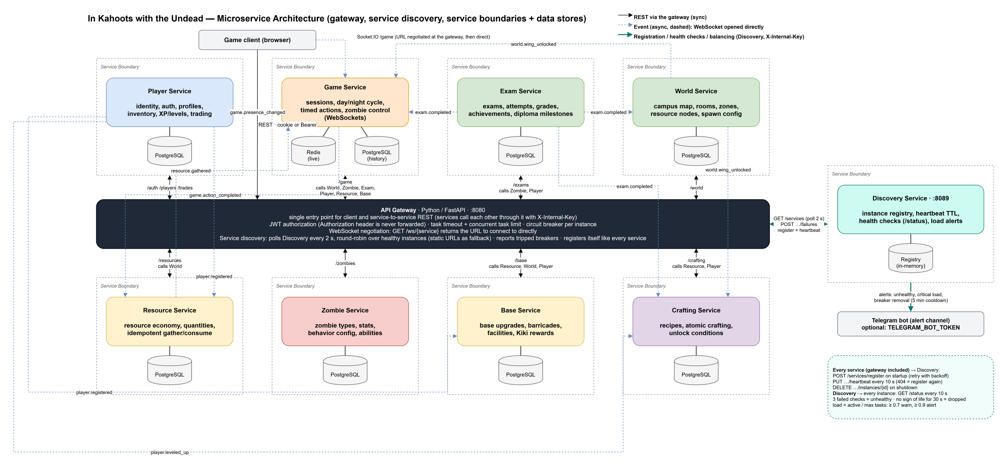

## Kahoot With Undead

A university-themed survival game built as a microservices system. Players wake up in FAF Cab
during a zombie apocalypse and must scavenge resources, build up their base, and fend off zombies —
including Professor Zombies, who force a pop quiz before letting you past. Passing exams unlocks new
wings of the university to explore, tying academic progress directly to survival progress.

[](https://hub.docker.com/r/timurcravtov/gateway)
[](https://hub.docker.com/r/inercaso/service-discovery)
[](https://hub.docker.com/r/timurcravtov/player-service)
[](https://hub.docker.com/r/timurcravtov/game-service)
[](https://hub.docker.com/r/inercaso/exam-service)
[](https://hub.docker.com/r/inercaso/world-service)
[](https://hub.docker.com/r/nevaletik/kahoot-zombie-service)
[](https://hub.docker.com/r/nevaletik/kahoot-resource-service)
[](https://hub.docker.com/r/mixam052/kahoots-base-service)
[](https://hub.docker.com/r/mixam052/kahoots-crafting-service)

[](docs/postman/service-discovery)
[](docs/postman/player-service)
[](docs/postman/game-service)
[](docs/postman/exam-service)
[](docs/postman/world-service)
[](docs/postman/zombie-service)
[](docs/postman/resource-service)
[](docs/postman/base-service)
[](docs/postman/crafting-service)


## Architecture



- **Gateway**: the single entry point: routing, authorization, task limits, WebSocket negotiation
- **Service Discovery**: the registry of running instances: health checks, load alerts, Telegram notifications
- **Player**: identity, auth, profiles, XP/levels, inventory, trading
- **Game**: sessions, day/night cycle, timed actions, zombie encounters
- **Exam**: exam generation, grading, academic history, achievements
- **World**: campus map: wings, rooms, resource nodes, spawn points
- **Zombie**: zombie type definitions, stats, abilities
- **Resource**: per-player resource balances and the gather/spend economy
- **Base**: what players have built: base level, facilities, barricades
- **Crafting**: recipes and crafting, delivering items into Player's inventory

Clients and services reach each other's REST APIs only through the Gateway (services
authenticate with `X-Internal-Key`); WebSocket URLs are negotiated at the Gateway and the
connection then goes directly to the service. Game orchestrates a session by calling World, Zombie
and Exam over REST; Resource, Base and
Crafting react to what Game reports via async events, and publish their own events (level-ups,
exam results, wing unlocks) for services that depend on them. See the [Communication
Contract](docs/communication.md) for the full endpoint and event contract.

## Running

`docker-compose.yml` brings up every published service together, each with its own Postgres
instance (one DB per service, no shared tables), pulling images from Docker Hub — it never builds
from a service's Dockerfile.

Requirements: Docker with Compose v2, and the service ports below free on your machine.

```
cp .env.example .env   # adjust credentials/tags if needed
docker compose -f docker-compose.client.yml up   # every service and the React client
docker compose up                                # every service, without the client
```

`docker-compose.yml` holds the backend; `docker-compose.client.yml` includes it and adds the client.

| Service | URL |
|---|---|
| **Client** (React app, only with `docker-compose.client.yml`) | http://localhost:3000 |
| **Gateway** (entry point) | http://localhost:8080 |
| Game (Socket.IO only) | http://localhost:8090 |
| Service Discovery (registry, `X-Internal-Key`) | http://localhost:8089 |

Only the gateway and Game's Socket.IO port are published, so every REST call from a client has to pass
the gateway's authorization. To reach a service directly while debugging (Player 8081, Exam 8083, World
8084, Zombie 8085, Resource 8086; each Base and Crafting replica gets a free host port, see
`docker compose port --index 1 base 8087`), add the override to either file:

```
docker compose -f docker-compose.yml -f docker-compose.dev.yml up
docker compose -f docker-compose.client.yml -f docker-compose.dev.yml up
```

**Scaling:** Player, Game, Exam, World, Zombie, Resource, Base and Crafting start with
`<SERVICE>_REPLICAS` (`PLAYER_REPLICAS`, `GAME_REPLICAS`, ...; 2 each) replicas. Every
replica registers with Service Discovery and the gateway balances across them, so replicas can be
added and removed while everything runs:

```
docker compose up -d --scale base=3      # a third replica registers, the gateway sends it requests
docker compose up -d --scale base=1      # two stop, deregister, and leave the rotation
curl -H 'X-Internal-Key: changeme' localhost:8089/services   # what Discovery sees
```

Each response from the gateway names the replica that answered in `X-Upstream-Instance`. Game
replicas keep lobbies, presence and the event stream in `game-db`, so any replica can serve any
request. Each replica publishes its Socket.IO port on the next free host port from
`GAME_HOST_PORT` (8090) to `GAME_HOST_PORT_LAST` (8099), but the gateway hands every browser the same
`GAME_PUBLIC_WS_URL`, so browser sockets all land on one replica; the others serve REST and the
`/events` stream.

### Gateway

- **Repository:** [`services/gateway`](https://github.com/TimurCravtov/KahootWithUndeadGateway),
  Python / FastAPI (the lab's "banned" language).
- **Image:** [`timurcravtov/gateway`](https://hub.docker.com/r/timurcravtov/gateway), version set
  by `GATEWAY_SERVICE_TAG` (currently `3`).
- **Routes** by the first path segment to the owning service (prefixes in the
  [Communication Contract](docs/communication.md#conventions)). Base, Crafting, Exam, World and
  Resource are configured to call other services through it, so all REST traffic, client and
  service-to-service, passes the gateway.
- **Authorizes** every client request: the login JWT (`Authorization: Bearer` or the
  `access_token` cookie) is verified with Player's JWKS (`GATEWAY_AUTH_MODE=jwks`; `secret` for
  HS256 with `GATEWAY_JWT_SECRET`, `off` to disable). The `Authorization` header is never forwarded;
  services receive the verified player as `X-Player-Id`. The `access_token` cookie is stripped
  too, so no service sees the token. Services authenticate with `X-Internal-Key`.
- **Limits:** requests past `GATEWAY_TASK_TIMEOUT` seconds answer `504`, requests beyond
  `GATEWAY_MAX_CONCURRENT_TASKS` in flight answer `429`. Zombie, Resource, Base and Crafting enforce
  the same limits themselves (`408` / `429`).
- **WebSockets:** `GET /ws/game` returns Game's Socket.IO URL for the browser and
  `GET /ws/{player|game|exam|world|resource}` (internal) the `/events` URL of one of the
  producer's instances. The gateway never relays the connection.
- **Service Discovery:** with `DISCOVERY_URL` it fetches every service's instances every 2 s and
  routes only to the healthy ones, **round-robin**, without asking Discovery per request. A service
  Discovery has never listed (it does not register yet) is reached at its `*_SERVICE_URL`; a listed
  service without a healthy instance answers `503`. When Discovery is down the last lists are kept.
  Every response names the instance that answered in `X-Upstream-Instance`.
- **Circuit breaker:** 3 failed calls (timeout, connection error or `5xx`) to one service within
  105 s (`GATEWAY_TASK_TIMEOUT` × 3.5) trip it and log `circuit breaker tripped`. A failing instance
  listed by Discovery leaves the rotation at once and is reported to Discovery; a service at its
  static URL is answered `503` at once for 105 s, then one trial request decides.
- **Status:** `GET /status` reports its load like every service, and the gateway registers itself
  with Discovery, which checks it like any other instance.
- **Try it:** http://localhost:8080/docs, health check `GET /health`.

### Service Discovery

- **Repository:** [`services/service-discovery`](https://github.com/inercaso/KahootWithUndeadDiscovery),
  Python / FastAPI (the lab's "banned" language).
- **Image:** [`inercaso/service-discovery`](https://hub.docker.com/r/inercaso/service-discovery),
  version set by `DISCOVERY_SERVICE_TAG` (currently `3`).
- **Registry:** every instance registers itself on startup (`POST /services/register` with its own
  container address), sends a heartbeat every few seconds and deregisters on shutdown; every service
  gets `DISCOVERY_URL: http://discovery:8089`. The gateway fetches `GET /services` every 2 s and
  routes to the healthy instances, round-robin. All registry routes need `X-Internal-Key`.
- **Health checks:** every `DISCOVERY_HEALTH_INTERVAL_S` (5 s) it calls each instance's `/status`;
  `DISCOVERY_FAILURE_THRESHOLD` (3) failed checks in a row take the instance out of rotation, and
  `DISCOVERY_HEARTBEAT_TTL_S` (30 s) without a sign of life drop it. A caller whose circuit breaker
  trips reports the instance with `POST /services/{service}/instances/{id}/failures`.
- **Alerts:** load is `active_tasks / max_concurrent_tasks` from `/status`. At
  `DISCOVERY_LOAD_WARN` (0.7) it logs a warning; at `DISCOVERY_LOAD_CRITICAL` (0.9), and when an
  instance stops answering, expires or is removed by a breaker, the alert also goes to Telegram,
  at most once per `DISCOVERY_ALERT_COOLDOWN_S` (300 s) per instance.
- **Telegram:** create a bot with @BotFather, add it to the team chat and send it `/chatid`; put
  the token in `TELEGRAM_BOT_TOKEN` and the chat ids, comma-separated, in `TELEGRAM_CHATS_IDS`
  in `.env` (never commit them). Without a token alerts only go to the log.
- **Try it:** `curl -H 'X-Internal-Key: changeme' localhost:8089/services` lists every instance with
  its health and load; `GET /status` and `GET /health` are public. The Postman collection in
  [`docs/postman/service-discovery`](docs/postman/service-discovery) (also as a single importable
  `service-discovery.postman_collection.json`) walks the registry (register, heartbeat, report a
  failure, deregister) and sends requests through the gateway to show `X-Upstream-Instance`
  changing between replicas. Swagger UI at
  http://localhost:8089/docs; API reference:
  [`docs/openapi/service-discovery.openapi.json`](docs/openapi/service-discovery.openapi.json).

### Client

- **Repository:** [`services/client`](https://github.com/M1XaM/kahoots-client), React / Vite, served
  by nginx. Runs from `docker-compose.client.yml`, which includes the whole backend.
- **Image:** [`mixam052/kahoots-client`](https://hub.docker.com/r/mixam052/kahoots-client), version
  set by `CLIENT_SERVICE_TAG` (currently `2`).
- **Talks to:** the Gateway only. The browser calls the client's own `/api`, which nginx proxies
  to `http://gateway:8080`, so no service is reached directly.
- **Has:** one page per service, a status page for all of them, and the gateway's access rules
  and load behaviour.
- **Sign-in:** players register and log in through the Gateway at Player Service; the login cookie
  is all the app needs. Its service actions (starting an exam, granting XP or resources) send
  `X-Internal-Key`, taken from `CLIENT_DEV_INTERNAL_KEY`: the key reaches the browser, so set it
  on a local machine only.
- **Try it:** `docker compose -f docker-compose.client.yml up`, then http://localhost:3000.

### Player Service

- **Image:** [`timurcravtov/player-service`](https://hub.docker.com/r/timurcravtov/player-service),
  version set by `PLAYER_SERVICE_TAG` (default `3`).
- **Needs:** its own Postgres (`player-db`, started by compose); password defaults to `qwerty`, override with `PLAYER_POSTGRES_PASSWORD`.
- **Talks to:** Game, over its event stream: it asks the gateway for the stream URL (`GATEWAY_URL`) and
  keeps `online` in step with `game.presence_changed`. It issues the login cookie, publishes the JWKS
  the gateway verifies it with, serves `POST /players/{id}/xp` and streams `player.registered` and
  `player.leveled_up` on `ws://player:8081/events`.
- **Try it:** Postman collection in [`docs/postman/player-service`](docs/postman/player-service).

### Game Service

- **Image:** [`timurcravtov/game-service`](https://hub.docker.com/r/timurcravtov/game-service),
  version set by `GAME_SERVICE_TAG` (default `3`), `GAME_REPLICAS` (2) replicas.
- **Needs:** its own Postgres (`game-db`, started by compose); password defaults to `qwerty`, override with `GAME_POSTGRES_PASSWORD`.
- **Scaling:** instance-agnostic: lobbies, the event outbox and which sockets are joined (so
  `game.presence_changed` fires when a player's first socket anywhere joins and their last one
  anywhere leaves) are all in `game-db`. A replica refreshes its sockets every 10 s, releases them on
  shutdown, and the survivors drop the ones of a replica that died after 30 s.
- **Talks to:** Player, World, Zombie, Exam, Resource and Base, always through the gateway
  (`GATEWAY_URL`, with `X-Internal-Key`). Until they run, starting a session or a timed action that
  depends on them will fail; creating lobbies works on its own. Game reads the acting player from
  `X-Player-Id`; the Socket.IO handshake checks the login cookie itself against Player's JWKS and
  publishes `game.presence_changed` on `ws://game:8082/events`.
- **Try it:** Postman collection in [`docs/postman/game-service`](docs/postman/game-service).
  Log in through the Player collection first, since Game authenticates with the login cookie.

### Exam Service

- **Image:** [`inercaso/exam-service`](https://hub.docker.com/r/inercaso/exam-service),
  version set by `EXAM_SERVICE_TAG` (currently `3`, the lab number; `latest` points at the newest).
- **Needs:** its own Postgres (`exam-db`, started by compose and seeded with the question bank and
  achievements from [`db/exam-service/init.sql`](db/exam-service/init.sql)); password defaults to
  `qwerty`, override with `EXAM_POSTGRES_PASSWORD`.
- **Talks to:** Zombie (a professor's subject) and Player (player check), always through the Gateway
  (`GATEWAY_URL`, with `X-Internal-Key`). `EXAM_ZOMBIE_CLIENT` / `EXAM_PLAYER_CLIENT` default to
  `http`; set them to `mock` to run Exam alone with built-in stand-ins (zombies `5`/`6`/`7` are
  math/physics/programming professors, `9` and `10` are not; every player id exists). Players are
  identified by the Gateway's `X-Player-Id`; the service never sees the token. Publishes
  `exam.completed` on `ws://exam:8083/events` (`GET /ws/exam` on the Gateway).
- **Limits:** a request past `EXAM_TASK_TIMEOUT_MS` (default 10 s) answers `408 REQUEST_TIMEOUT`;
  beyond `EXAM_MAX_CONCURRENT_TASKS` (default 100) in flight, `429 TOO_MANY_REQUESTS` with
  `Retry-After`.
- **Try it:** the Postman collection in [`docs/postman/exam-service`](docs/postman/exam-service)
  (also as a single importable `exam-service.postman_collection.json`) goes through the Gateway:
  run **Auth (run first)** to register and log in a player, then create and answer an exam.

### World Service

- **Image:** [`inercaso/world-service`](https://hub.docker.com/r/inercaso/world-service),
  version set by `WORLD_SERVICE_TAG` (currently `3`, the lab number; `latest` points at the newest).
- **Needs:** its own Postgres (`world-db`, started by compose and seeded with the campus map from
  [`db/world-service/init.sql`](db/world-service/init.sql)); password defaults to `qwerty`,
  override with `WORLD_POSTGRES_PASSWORD`.
- **Talks to:** Exam, over its event stream, negotiated at the Gateway (`WORLD_EXAM_EVENTS_URL`,
  default `gateway`: `GET /ws/exam`, then a direct connection; `off` = not connected, then events can
  be delivered over HTTP at `POST /world/internal/events`). A passed `exam.completed` unlocks the
  matching wing and publishes `world.wing_unlocked` on `ws://world:8084/events` (`GET /ws/world` on
  the Gateway). Players are identified by the Gateway's `X-Player-Id`; the service never sees the
  token.
- **Limits:** `WORLD_TASK_TIMEOUT_MS` (default 10 s, then `408 REQUEST_TIMEOUT`) and
  `WORLD_MAX_CONCURRENT_TASKS` (default 100, then `429 TOO_MANY_REQUESTS` with `Retry-After`).
- **Try it:** the Postman collection in [`docs/postman/world-service`](docs/postman/world-service)
  (also as a single importable `world-service.postman_collection.json`) goes through the Gateway:
  run **Auth (run first)**, then pass an exam through the Exam collection and the matching wing
  shows `unlocked: true`.

### Zombie Service

- **Image:** [`nevaletik/kahoot-zombie-service`](https://hub.docker.com/r/nevaletik/kahoot-zombie-service),
  version set by `ZOMBIE_SERVICE_TAG` (currently `2`, the lab number; each release is also tagged
  `<lab>.<minor>.<patch>` and `latest`).
- **Needs:** its own Postgres (`zombie-db`, started by compose and seeded from
  [`db/zombie-service/init.sql`](db/zombie-service/init.sql) with ten definitions: ids `5`/`6`/`7`
  are the math/physics/programming professors, `9` and `10` are not, matching Exam's stand-in);
  password defaults to `qwerty`, override with `ZOMBIE_POSTGRES_PASSWORD`.
  `INTERNAL_KEY` is the `X-Internal-Key` every route except the health check expects.
- **Talks to:** nobody. Players reach `GET /zombies/{id}` through the Gateway, which verifies the
  token and forwards the player as `X-Player-Id`; the service never sees the token.
- **Try it:** the Postman collection in [`docs/postman/zombie-service`](docs/postman/zombie-service)
  (also as a single importable `zombie-service.postman_collection.json`) goes through the Gateway:
  run **Auth (run first)** to register and log in a player. API reference:
  [`docs/openapi/zombie-service.openapi.json`](docs/openapi/zombie-service.openapi.json) (Swagger UI
  is served at `/docs` on the service port, which compose does not publish).

### Resource Service

- **Image:** [`nevaletik/kahoot-resource-service`](https://hub.docker.com/r/nevaletik/kahoot-resource-service),
  version set by `RESOURCE_SERVICE_TAG` (currently `2`, the lab number; each release is also tagged
  `<lab>.<minor>.<patch>` and `latest`).
- **Needs:** its own Postgres (`resource-db`, started by compose and seeded from
  [`db/resource-service/init.sql`](db/resource-service/init.sql) with balances and ledger history
  for players `1`-`3`); password defaults to `qwerty`, override with `RESOURCE_POSTGRES_PASSWORD`.
  Other players get balances when `player.registered` is delivered for them.
- **Talks to:** Player and Game over their `/events` streams, negotiated at the Gateway
  (`RESOURCE_PLAYER_EVENTS_URL` / `RESOURCE_GAME_EVENTS_URL`, default `gateway`; empty = not
  connected, then events can be delivered over HTTP at `POST /resources/internal/events`), and World
  for node resource types through the Gateway (`RESOURCE_WORLD_SERVICE_URL`, default
  `http://gateway:8080`; empty = built-in copy of the rooms). It publishes `resource.gathered` on
  `ws://resource:8086/events` (`GET /ws/resource` on the Gateway). Players are identified by the
  Gateway's `X-Player-Id`; Base and Crafting reserve/commit through it with `INTERNAL_KEY`.
- **Try it:** the Postman collection in [`docs/postman/resource-service`](docs/postman/resource-service)
  (also as a single importable `resource-service.postman_collection.json`) goes through the Gateway:
  run **Auth (run first)** to register and log in a player, who gets zero balances from
  `player.registered`. Players `1`-`3` are seeded; the Events folder gives player 42 balances. API
  reference: [`docs/openapi/resource-service.openapi.json`](docs/openapi/resource-service.openapi.json)
  (Swagger UI is served at `/docs` on the service port, which compose does not publish).

### Base Service

- **Image:** [`mixam052/kahoots-base-service`](https://hub.docker.com/r/mixam052/kahoots-base-service),
  version set by `BASE_SERVICE_TAG` (currently `3`), `BASE_REPLICAS` (2) replicas.
- **Needs:** its own Postgres (`base-db`, started by compose); password defaults to `qwerty`, override with `BASE_POSTGRES_PASSWORD`.
- **Talks to:** Resource, World and Player over REST through the Gateway (`GATEWAY_URL`). Until
  they run, spending endpoints (upgrades, barricades, Kiki) return `503 SERVICE_UNAVAILABLE`;
  reading and creating bases work on their own. It consumes `player.registered` from Player's
  `/events` stream, negotiated at the Gateway, so a new player gets a base right after registering.
- **Limits:** `BASE_TASK_TIMEOUT_MS` (`408`) and `BASE_MAX_CONCURRENT_TASKS` (`429`), per replica.
- **Scaling:** each replica registers with Service Discovery and answers `GET /status` with its load.
  Only one replica consumes Player's event stream at a time (a PostgreSQL advisory lock; another
  takes over within 5 s), every event is applied once in a transaction, and an `Idempotency-Key` is
  claimed in the database before the request runs, so a duplicate on another replica gets
  `409 IDEMPOTENCY_KEY_IN_USE`.
- **Circuit breaker:** 3 failed calls to one service within 35 s (task timeout × 3.5) trip it; the
  failing instance named by the gateway's `X-Upstream-Instance` is reported to Discovery, otherwise
  calls to that service fail fast with `503` for 35 s.
- **Logs:** one JSON line per event in the shared format; `BASE_LOG_LEVEL` (`info`).
- **Try it:** Postman collection in [`docs/postman/base-service`](docs/postman/base-service).

### Crafting Service

- **Image:** [`mixam052/kahoots-crafting-service`](https://hub.docker.com/r/mixam052/kahoots-crafting-service),
  version set by `CRAFTING_SERVICE_TAG` (currently `3`), `CRAFTING_REPLICAS` (2) replicas.
- **Needs:** its own Postgres (`crafting-db`, started by compose); password defaults to `qwerty`, override with `CRAFTING_POSTGRES_PASSWORD`.
  Seeded from [`db/crafting-service/init.sql`](db/crafting-service/init.sql) with five recipes
  (two gated: one by level, one by a passed math exam and the Math Wing); their output items are
  seeded into Player's catalogue by [`db/player-service/init.sql`](db/player-service/init.sql).
- **Talks to:** Resource and Player over REST through the Gateway (`GATEWAY_URL`). Until they run,
  crafting returns `503 SERVICE_UNAVAILABLE`; recipes and availability work on their own. It
  consumes Player's, Exam's and World's `/events` streams, negotiated at the Gateway, to track
  levels, passed subjects and unlocked wings.
- **Limits:** `CRAFTING_TASK_TIMEOUT_MS` (`408`) and `CRAFTING_MAX_CONCURRENT_TASKS` (`429`), per replica.
- **Scaling:** like Base: registers with Service Discovery, one replica per event stream (Player,
  Exam, World), events applied once, `Idempotency-Key` claimed before a craft runs.
- **Circuit breaker:** like Base, for its calls to Resource and Player.
- **Logs:** shared JSON format; `CRAFTING_LOG_LEVEL` (`info`).
- **Try it:** Postman collection in [`docs/postman/crafting-service`](docs/postman/crafting-service).

## GitHub Workflow

- **Branches**: `main` is protected: no direct pushes, merges only through a reviewed PR, CI must
  pass. `dev` is the integration branch everyone works off; feature work branches off `dev`
  and merges back into it, and `dev` is merged into `main` for releases.
- **Naming**: `feature/<short-description>`, `fix/<short-description>`, `chore/<short-description>`
  (e.g. `feature/resource-reservations`).
- **Commits**: follow [Conventional Commits](https://www.conventionalcommits.org):
  `type(scope)!: description`, where `(scope)` and `!` are optional. Use the imperative mood,
  lowercase, no trailing period (e.g. `feat(auth): add login endpoint`,
  `fix(db): correct migration order`, `feat(auth)!: change token format`).
  - Types: `feat`, `fix`, `chore`, `docs`, `refactor`, `test`, `ci`, `build`, `perf`.
  - Scope: the module or area touched, such as `auth`, `inventory` or `session`.
  - `!` marks a breaking API/event change and describes it in the commit body.
  - The release workflow reads these subjects to pick the version: `!` bumps `MAJOR`, `feat` bumps
    `MINOR`, anything else bumps `PATCH`. Because `dev` uses rebase merges, every commit in a PR
    reaches history as written, so each one must follow the format, not just the PR title.
  - The `Commit message check` action validates every commit in PRs into `dev` and `main`. Merge
    commits (e.g. `Merge branch 'main' into dev`) are skipped.
- **Merging**: into `dev`, use rebase and merge (linear history, each commit is kept). Into
  `main`, use a merge commit so each release is a single visible merge point. Squash merge is not
  used. Requires 1 approval and a passing CI run before the merge button unlocks.
- **PR content**: what changed and why, which service(s) it touches, how it was tested, and any
  follow-up work left out of scope. Linked to the relevant task/issue.
- **Auto draft PR**: the `Auto draft PR` workflow (`.github/workflows/auto-draft-pr.yml`) opens a
  draft PR into `dev` on the first push of any new branch, titled `Draft: <latest commit subject>`.
  It assigns the pusher, requests review from the rest of the team and Copilot, and fills the body
  with an AI summary of the commits and diff (via GitHub Models, with a static fallback).
- **Draft title guard**: the `PR title check` workflow (`.github/workflows/pr-title-check.yml`)
  fails while the PR title starts with `Draft`, so the author must rename the PR before it can
  merge. It only blocks merging once `no-draft-title` is a required status check in branch
  protection, and "Allow GitHub Actions to create pull requests" must be enabled in repo settings.
- **Test coverage**: new logic needs tests before merge; CI fails the build below the coverage
  threshold. Reviewers can ask for more coverage on a case-by-case basis.
- **Versioning**: semantic versioning per service (`MAJOR.MINOR.PATCH`), tagged on `main` at each
  release. Breaking API/event changes bump `MAJOR`.

## Documentation

- [Technologies](docs/technologies.md): tech stack per service and the trade-offs behind each choice.
- [Communication Contract](docs/communication.md): data ownership, endpoints and event payloads across services.
